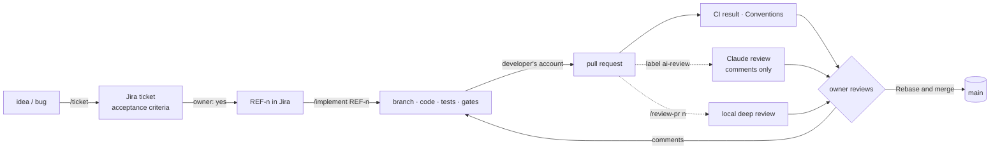

# AI workflow — spec → ticket → code → PR → review → human merge

The AI does the typing; **humans decide**. Every change still follows [CLAUDE.md](../CLAUDE.md) §3 and the
[pull-request workflow](pr-workflow.md). This page covers what is specific to the AI. Decision: [ADR 0012](adr/0012-ai-workflow.md).

## Who owns the code
The AI is a tool, like the IDE or a code generator. The developer who runs the session is the **author**: commits,
pushes and pull requests go out from **their own** GitHub account, and they answer for the code in review, whoever
or whatever typed it. Commits the AI wrote carry the trailer `Co-Authored-By: Claude …`, so `git log` still shows
where it helped.

| Rule | |
|---|---|
| Read before you ship | the developer reads the diff before the PR is opened — "the AI wrote it" is never an answer in review |
| Another human approves | in a team, `main` requires 1 approval from a code owner who did not write the PR. RefProj has one person, so the ruleset requires **0 approvals** ([ci-cd.md → Approvals](ci-cd.md#settings-as-code)); the checks, the PR checklist and the AI review are the safety net |
| The AI never decides | it never approves, merges, enables auto-merge or uses `--admin`, and never pushes to `main` (CLAUDE.md §3.7) |

A separate GitHub identity for the AI (a GitHub App) was considered and rejected: it only works around "authors
cannot approve their own PR", and in a team a colleague approves anyway (ADR 0012).

## The loop

| Step | Who | How |
|---|---|---|
| Spec → ticket | AI drafts, **owner approves** | `/ticket <idea>` — duplicates check, acceptance criteria, flag, test plan; created in Jira only after a yes |
| Ticket → PR | AI | `/implement REF-n` — branch, code, tests, gates, both apps run, commits + PR from the developer's account, ticket → *In Review* |
| Review | AI (advisory) | label **`ai-review`** on the PR (CI, Claude Haiku) or `/review-pr n` locally (deeper, current model) — comments, never approvals |
| Decision | **owner** | reads the diff and the AI's comments, resolves every thread, *Rebase and merge* (in a team: a colleague approves first) |

The skills live in [`.claude/skills/`](../.claude/skills/) and are only started by a person (`disable-model-invocation`):
[`ticket`](../.claude/skills/ticket/SKILL.md), [`implement`](../.claude/skills/implement/SKILL.md),
[`review-pr`](../.claude/skills/review-pr/SKILL.md) with its shared [checklist](../.claude/skills/review-pr/checklist.md).
Jira access: [jira.md → Access](jira.md#access).
