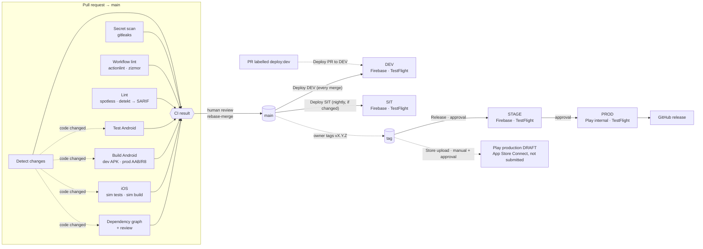

# CI/CD

GitHub Actions builds, tests and ships both apps. Every pipeline step calls the same **fastlane lanes** developers
use locally (`bundle exec fastlane …`), so there is no CI-only build logic. Decisions and trade-offs: [ADR 0006](adr/0006-ci-cd.md).

## Pipeline



| Workflow | Trigger | What | Secrets |
|---|---|---|---|
| [`ci.yml`](../.github/workflows/ci.yml) | every PR (also stacked PRs), push to `main` | Quality gate; the required check is **`CI result`** | none |
| [`deploy-main.yml`](../.github/workflows/deploy-main.yml) | push to `main` (code changes, not docs) | DEV, both platforms | `dev` |
| [`deploy-sit.yml`](../.github/workflows/deploy-sit.yml) | 02:00 UTC Mon–Fri (skipped if `main` is already in SIT), or manual | SIT, both platforms | `sit` |
| [`deploy-pr.yml`](../.github/workflows/deploy-pr.yml) | label **`deploy:dev`** on a PR, and every push to it while labelled | DEV preview of the PR (merged into its base), both platforms | `dev` |
| [`release.yml`](../.github/workflows/release.yml) | tag `vX.Y.Z` on `main` | STAGE → PROD (each needs approval), then a GitHub release | `stage`, `prod` |
| [`store-release.yml`](../.github/workflows/store-release.yml) | manual, run **from a tag** | Play production draft / App Store Connect upload | `prod` |
| [`_distribute.yml`](../.github/workflows/_distribute.yml) | called by the deploy workflows | One platform → one environment via `fastlane <platform> <beta\|release>` | the environment's |

Where each environment's build goes is defined in [ADR 0005](adr/0005-release-tooling.md#distribution-per-environment).
**Nothing reaches end users without a human:** Play rollout and App Review submission happen in the store consoles.

### Docs-only pull requests
A pull request that only changes documentation skips **Test (Android host)**, **Build (Android)**, **Test + build (iOS)**
and **Dependency graph + review**; they show as *skipped* and `CI result` still passes. Secret scan, workflow lint and
lint (Spotless also checks `*.md`) always run. The job **Detect changes** runs
[`scripts/ci/changes.sh`](../scripts/ci/changes.sh), which only reports *docs-only* when **every** changed file
matches the allowlist (`*.md`, `docs/**`, `.github/ISSUE_TEMPLATE/**`, the same as `deploy-main.yml`'s
`paths-ignore`). Anything else runs the full pipeline; so do pushes to `main` and manual runs.

The workflow itself is never filtered with `paths`/`paths-ignore`: `CI result` is a required check, and a workflow
that does not start never reports it, so the pull request could not be merged. `CI result` also fails if
*Detect changes* fails, so a broken detection can never skip the checks silently.

## Releasing
1. Make sure `main` is green and DEV/SIT have been tested (run *Deploy SIT* manually if the nightly build is too old).
2. Tag the commit on `main` (only admins may create `v*` tags — ruleset `release-tags`):
   ```bash
   git switch main && git pull
   git tag -a v1.2.0 -m "v1.2.0" && git push origin v1.2.0
   ```
3. *Actions → Release* → **Review deployments** → approve `stage`. Test STAGE.
4. Approve `prod`. Android lands on the Play **internal** track, iOS in TestFlight. A GitHub release with generated notes is created.
5. When ready for the stores: *Actions → Store upload → Run workflow*, **Use workflow from → Tags → v1.2.0**, approve `prod`.
6. Roll out in Play Console / submit for review in App Store Connect.

Hotfix: branch from the tag, fix through a PR to `main` as usual, then tag the new `main` commit `vX.Y.(Z+1)`.

## Versions and build numbers
`versionName` comes from the tag (main builds get the next minor), the build number is *minutes since 2026-01-01 UTC*
([ADR 0005](adr/0005-release-tooling.md#versioning)). Each workflow run computes it **once** (`prepare` job) and passes
it to every job, so Android and iOS of one run carry the same number.

## Security model
| Control | Where |
|---|---|
| `main` only changes through PRs with a green **`CI result`**, linear history, resolved threads; no force-push or deletion | ruleset `main` |
| Release tags `v*` can only be created/moved/deleted by admins | ruleset `release-tags` |
| Secrets are **environment** secrets. `sit` accepts only `main`; `dev` accepts `main` and PR merge refs (`refs/pull/*/merge`, for `deploy:dev` previews); `stage`/`prod` accept only `v*` tags and need a reviewer | GitHub Environments |
| PR previews (`deploy:dev`) only for branches of this repository, never forks or Dependabot; only collaborators with write access can add labels. They reach `dev` only — never `sit`, `stage` or `prod` | `deploy-pr.yml`, GitHub Environments |
| **No repository- or organization-level secrets.** Deploy callers pass `secrets: inherit` (a called workflow sees no secrets otherwise, not even its environment's), so a repository-level secret would reach every deploy job | GitHub Environments |
| `GITHUB_TOKEN` is read-only by default; jobs request extra scopes explicitly | workflow `permissions:` |
| Only GitHub-owned actions plus `gradle/actions` and `ruby/setup-ruby`, **pinned to a full commit SHA** (enforced) | Actions settings |
| Pinned CLI tools are checksum-verified before use | [`scripts/ci/install-tool.sh`](../scripts/ci/install-tool.sh) |
| Workflows from first-time and outside contributors wait for approval; fork PRs never see secrets | Actions settings |
| File secrets are written to `$RUNNER_TEMP` with mode 600 and deleted after the job | [`scripts/ci/secret-files.sh`](../scripts/ci/secret-files.sh) |
| Secret scanning + push protection, Dependabot alerts + security updates, private vulnerability reporting | Security settings |
| Code scanning: detekt (SARIF) and CodeQL for workflow files | Security tab |
| iOS signing: read-only **deploy key** on the match repo, no personal token | `MATCH_GIT_PRIVATE_KEY` |

The repository is **public** (see ADR 0006): logs and artifacts are visible to everyone. GitHub masks secret values in logs;
never `echo` a secret or upload a release-signed build as a workflow artifact. Only the DEV debug APK (debug key) is uploaded.

## Settings as code
Repository settings live in [`.github/settings/`](../.github/settings/) and
[`scripts/github/configure-repo.sh`](../scripts/github/configure-repo.sh) (idempotent; re-run after changing them).
CI secrets are copied from the owner's machine by [`scripts/github/set-ci-secrets.sh`](../scripts/github/set-ci-secrets.sh);
the full inventory is in [secrets.md](secrets.md).

**Approvals:** the ruleset requires a PR but **0 approving reviews**, because GitHub does not let an author approve their
own PR and all PRs are currently opened from the owner's account. Plan step 8 gives the AI its own GitHub identity; the
required approvals then go to 1 (`required_approving_review_count` in `ruleset-main.json`).

## Caching
- Gradle: `gradle/actions/setup-gradle` (dependencies, wrapper, build cache). Written from `main` only; PRs read it.
- Kotlin/Native toolchain (`~/.konan`, ~1 GB): `actions/cache`, keyed on the version catalog.
- Ruby gems: `ruby/setup-ruby` with `bundler-cache`.
- Concurrency: a new push to a PR cancels its running CI; deploys and releases queue and are never cancelled.

## Dependency updates
Dependabot ([`.github/dependabot.yml`](../.github/dependabot.yml)) opens grouped weekly PRs for Gradle, GitHub Actions
(SHA pins included) and Ruby gems, after a 7-day cooldown. Security updates arrive immediately. Not covered — bump by hand:
the CLI tools in `scripts/ci/install-tool.sh`, `detekt-kotlin`, `ktlint`, `compose-rules`, Xcode in
`.github/actions/setup-build`.

### Vulnerable build tooling
Dependency review also scans the **build toolchain** (AGP, Android Lint, Kotlin tooling), not only app libraries. When the
latest stable toolchain still resolves a vulnerable library:
1. **Pin** a fixed version in the `build-tool-security-pins` bundle of `gradle/libs.versions.toml` (advisory listed next
   to the version). It is applied to the build classpath (root `build.gradle.kts`) and to tool classpaths inside the
   modules (`build-logic/.../ToolClasspathPins.kt`). Verify signing, lint and both platform builds afterwards.
2. Only if a pin is impossible, **accept the risk** in `allow-ghsas` of the *Review vulnerabilities* step in `ci.yml`, with the
   reason and an exit condition in a comment, and list it below.
3. Re-check pins and exceptions whenever AGP, Kotlin or Gradle is upgraded; drop what is no longer needed.

| Accepted advisory | Where | Why it can't be pinned | Remove when |
|---|---|---|---|
| GHSA-r937-wjx7-w2jp (moderate) | Kotlin 2.4.10 embedded in Gradle 9.8.1, used by `build-logic`'s `kotlin-dsl` | Embedded Kotlin is part of Gradle itself | Gradle embeds Kotlin ≥ 2.4.20 |

### License policy
Every PR that adds or upgrades a dependency **that ships in an app** must use an allowed license — an allowlist of
permissive licenses in [`.github/license-policy.yml`](../.github/license-policy.yml), checked by the *Review licenses*
step. Tiers, rationale and the baseline: [ADR 0008](adr/0008-license-policy.md).

- **Ships** = runtime scope in the dependency graph: `:app:android`'s variant runtime classpaths and `:app:shared`'s iOS
  klibraries (`DEPENDENCY_GRAPH_RUNTIME_*` in `ci.yml`). Build and test tooling is development scope: not
  license-checked, but still vulnerability-checked (*Review vulnerabilities*, all scopes).
- **When it fails:** the job log lists the package and its license. Pick another library, or — for weak copyleft such as
  MPL-2.0 used unmodified — ask the code owner for an exception in `allow-dependencies-licenses` (package URL + reason).
  GPL, AGPL, SSPL and non-commercial licenses are never excepted.
- **Not covered:** packages GitHub has no license data for (listed in the log, they do not fail) and Swift packages
  (not in the graph). Check those by hand in review.

## Runners
| Job | Runner |
|---|---|
| Everything on Linux | `ubuntu-24.04` (GitHub-hosted) |
| PR checks on macOS | `macos-26` (GitHub-hosted) — **always** |
| iOS deploys of `main` and tags (`_distribute.yml`) | `macos-26`, or the self-hosted Mac when the repository variable `MACOS_RUNNER` is set |
| iOS PR previews (`deploy-pr.yml`) | `macos-26` — **always** (`trusted: false`) |

Public repositories get GitHub-hosted runners (macOS included) free of charge, so the self-hosted Mac (plan phase 2) is
**optional** — useful only for speed (warm caches) or if the repository becomes private again.

### Self-hosted Mac runner (optional)
Pull-request code must **never** run on it: on a public repository anyone can open a PR, and a self-hosted runner executes
that code on the owner's machine with access to its keychain and files. That is why only `_distribute.yml` can use it, and
only for trusted refs (`main`, release tags): PR previews pass `trusted: false` and always use a GitHub-hosted runner.

1. Create a separate macOS user account (e.g. `ci`) without admin rights; install Xcode 26.6, Homebrew bash, rbenv/Ruby from
   `.ruby-version`, and JDK 25 there.
2. GitHub → repository → *Settings → Actions → Runners → New self-hosted runner → macOS / ARM64*. Follow the commands as the
   `ci` user, adding the label `refproj-mac` when asked. Install it as a service (`./svc.sh install && ./svc.sh start`).
3. *Settings → Secrets and variables → Actions → Variables → New repository variable*: `MACOS_RUNNER` = `refproj-mac`.
4. To go back to GitHub-hosted runners, delete the variable. To retire the runner: `./svc.sh uninstall`, then remove it in
   *Settings → Actions → Runners*.

## Testing a pull request before merge (`deploy:dev`)
1. Open the PR (a branch in this repository) and add the label **`deploy:dev`**.
2. *Deploy PR to DEV* builds the PR merged into its base and uploads it to DEV testers (App Distribution / TestFlight).
   Every push to the PR while it is labelled deploys again.
3. Remove the label when done. After merge, *Deploy DEV* ships `main` as usual.

The label and the `refs/pull/*/merge` rule on the `dev` environment are created by `scripts/github/configure-repo.sh`.
