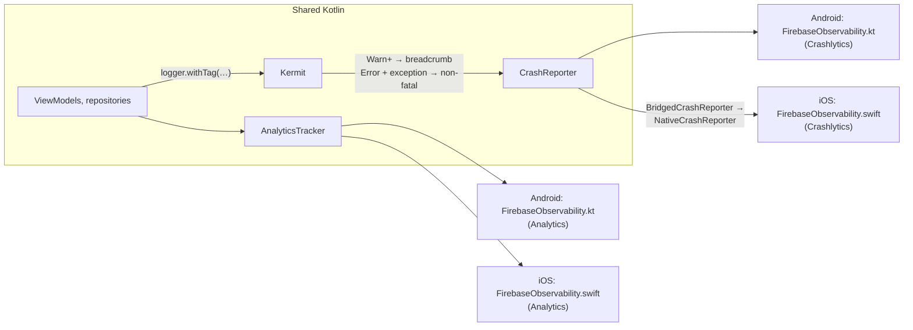

# Observability

Structured logging (Kermit), crash reporting (Firebase Crashlytics) and product analytics (Firebase Analytics),
behind interfaces in `core:observability` so shared code never touches a vendor SDK.

## Logging
- Inject `co.touchlab.kermit.Logger` and tag it: `logger.withTag("Sync").i { "Synced $count items" }`.
- Debug builds log `Debug` and up to Logcat / OSLog; release builds `Info` and up.
- `Warn` and up become Crashlytics breadcrumbs; `Error` with an exception becomes a non-fatal report.
- HTTP: debug builds log request lines and headers (never bodies) with `Authorization`/cookies redacted;
  release builds log no requests (`HttpClientTest` checks both).
- **Never log secrets, tokens or personal data.** Logs end up in crash reports.

## Crash reporting
| | Android | iOS |
|---|---|---|
| SDK | Firebase Crashlytics (BoM in the version catalog) | Firebase iOS SDK via Swift Package Manager, pinned in `iosApp/project.yml` + `iosApp/Package.resolved` |
| Kotlin crashes | Native JVM stack traces | `installUnhandledExceptionReporting` records the Kotlin exception with its Kotlin stack before the app terminates |
| Symbols | R8 mapping uploaded by the Crashlytics Gradle plugin (release builds with Firebase config) | dSYM (includes the static Kotlin framework) uploaded by the *Upload symbols to Crashlytics* build phase (release builds) |
| Custom keys | `environment` | `environment` |

## Analytics
- Events are `AnalyticsEvent(name, parameters)`, validated against Firebase's naming limits at creation.
- iOS links `FirebaseAnalyticsCore` (no advertising-ID or ad-conversion code). Both platforms deny ad storage, ad user
  data and ad personalisation by default and never collect an advertising ID.
- **No personal data** in event names, parameters or user IDs (use a pseudonymous ID, never an e-mail address).

## When data is collected
| Build | Crashlytics | Analytics |
|---|---|---|
| Debug (any environment) | off | off |
| Release, DEV/SIT/STAGE | on | on |
| Release, PROD | on | on (consent prompt: open item for the onboarding feature) |
| No Firebase config (PR checks, forks) | not initialised (no-op) | not initialised (no-op) |

Collection is **off by default** in `AndroidManifest.xml` / `Info.plist` and switched on at startup by
`FirebaseObservability` (Kotlin on Android, Swift on iOS), so nothing is sent before the app decides.

## Versions
- Android: `firebase-bom`, `firebase-crashlytics-gradle`, `google-services` in `gradle/libs.versions.toml` (Dependabot).
- iOS: `packages.Firebase.exactVersion` in `iosApp/project.yml`. Policy: the latest release that is at least two weeks old.
  Update: change the version, run `cd iosApp && xcodegen generate`, resolve packages in Xcode (*File → Packages → Resolve
  Package Versions*), copy `RefProj.xcodeproj/project.xcworkspace/xcshareddata/swiftpm/Package.resolved` to
  `iosApp/Package.resolved`, commit both. CI builds only with the committed lockfile (`-disableAutomaticPackageResolution`).

## Known log messages
- `SecItemCopyMatching (-34018)` in **unsigned** simulator builds (`fastlane ios build`): no keychain entitlement
  without code signing, so Firebase Installations (and `SecureStore`) cannot use the Keychain. Signed builds and
  runs from Xcode ("Sign to Run Locally") are not affected.
- Crashlytics `std::get_terminate is … kotlinHandler`: Kotlin/Native installs its own terminate handler. Uncaught
  Kotlin exceptions are still reported (`installUnhandledExceptionReporting` + the resulting crash signal).
