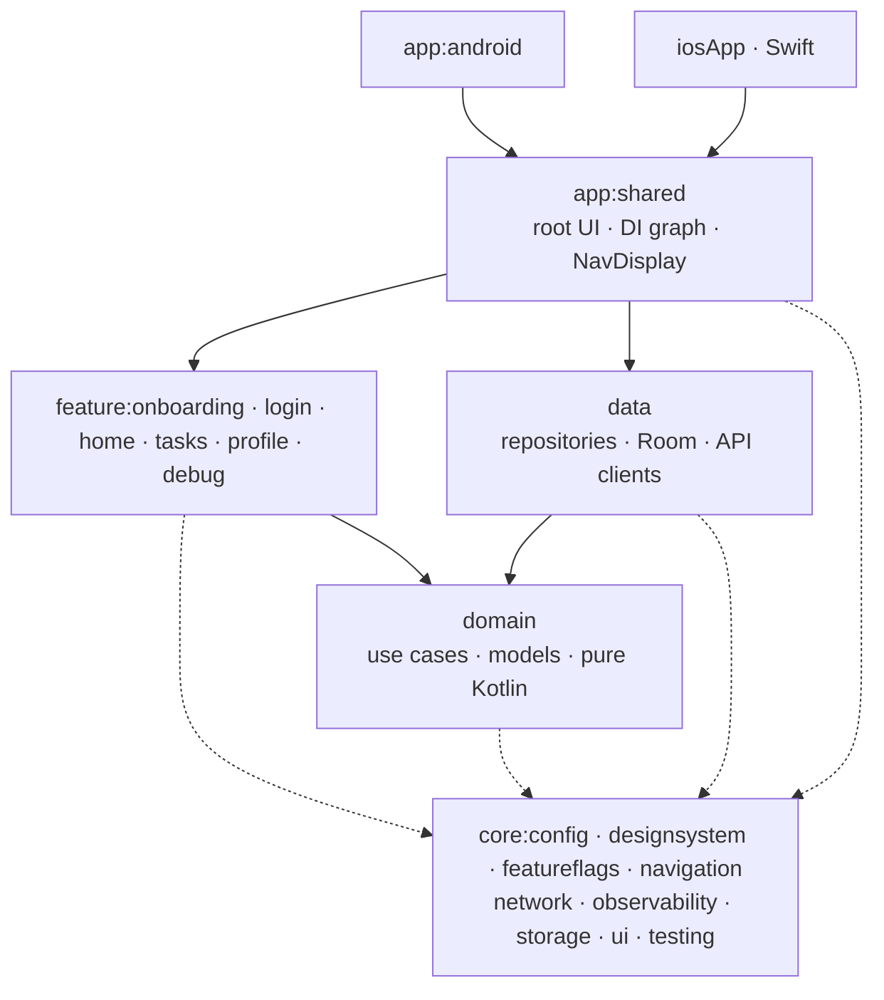
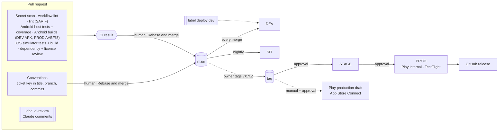
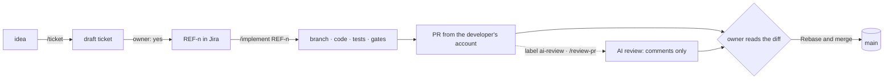

# RefProj — the complete setup

One page that explains the whole project end to end. Each section is a summary and links to the detailed doc
or decision record (ADR). The aim is that a new developer or reviewer understands the setup without reading the
step logs.

**What it is:** an enterprise reference project, a Compose Multiplatform app for Android and iOS. The setup is the
point: source code, environments, secrets, CI/CD, tests, observability, Jira and an AI-assisted workflow, all
working together. What the app *does* is secondary.

**At a glance**

| | |
|---|---|
| Platforms | Android + iOS, shared UI and logic in Kotlin (Compose Multiplatform) |
| Modules | 20 Gradle modules: 2 app, 9 core, `domain`, `data`, 6 features, architecture tests |
| Environments | DEV, SIT, STAGE, PROD, each a separate installable app |
| Tests | 53 labelled test classes on the Android host + iOS simulator, plus nightly on-device tests; 89 % line coverage |
| Pipelines | 10 GitHub Actions workflows; every PR needs **`CI result`** and **`Conventions`** |
| Traceability | Jira project `REF`: every branch, commit and PR names a ticket |
| Decisions | 12 ADRs in [`docs/adr/`](adr/README.md) |

## Contents
1. [The app](#1-the-app)
2. [Architecture and modules](#2-architecture-and-modules)
3. [Environments](#3-environments)
4. [Secrets and signing](#4-secrets-and-signing)
5. [Build and release tooling](#5-build-and-release-tooling)
6. [CI/CD pipeline](#6-cicd-pipeline)
7. [Tests](#7-tests)
8. [Observability](#8-observability)
9. [Feature flags and trunk-based development](#9-feature-flags-and-trunk-based-development)
10. [Debug menu](#10-debug-menu)
11. [Design system and localisation](#11-design-system-and-localisation)
12. [Linting and quality gates](#12-linting-and-quality-gates)
13. [Jira and the AI workflow](#13-jira-and-the-ai-workflow)
14. [Known gaps and next steps](#14-known-gaps-and-next-steps)
15. [Where to read more](#15-where-to-read-more)

## 1. The app
A small personal task tracker: **onboarding → login → tab shell** (Home · Tasks · Profile).

- **Onboarding:** three pages. The last page asks for analytics consent (opt-in).
- **Login:** a fake auth backend (`FakeAuthApi`) with a public demo account. The session is stored in secure storage
  (Android Keystore / iOS Keychain) and restored at start-up.
- **Tabs:** each tab has its own back stack. Tasks are stored on the device in a Room database. Logging out deletes
  the tasks.

The root (`AppViewModel`) picks the top-level screen from the app state, so screens never navigate after login,
logout or onboarding. → [features.md](features.md)

## 2. Architecture and modules
**Clean Architecture + MVVM with unidirectional data flow.** Each screen has one ViewModel, which exposes one
`StateFlow<UiState>` and takes `UiAction`s. Koin injects every dependency through constructors. Navigation 3 handles
navigation, with route keys in `core:navigation`.



| Rule | Enforced by |
|---|---|
| `app → feature → domain ← data`; every layer may use `core` | `LayerDependencyTest` (Konsist) |
| A feature never depends on another feature or on `data` | `LayerDependencyTest` |
| `domain` is pure Kotlin: no Compose, platform APIs or Ktor | `LayerDependencyTest` |
| ViewModels, use cases and repositories follow one shape | `ConventionsTest` |
| Only `app:shared` sees everything, as the single composition root | module graph |

**Modules:** `app:android`, `app:shared` (exported to iOS as `Shared.framework`); `core:config`, `designsystem`,
`featureflags`, `navigation`, `network`, `observability`, `storage`, `testing`, `ui`; `domain`; `data`;
`feature:debug`, `home`, `login`, `onboarding`, `profile`, `tasks`; `tests:architecture`. Shared build logic lives in
convention plugins (`build-logic/`, `refproj.*`), and every version lives in `gradle/libs.versions.toml`.

| Concern | Choice | ADR |
|---|---|---|
| UI | Compose Multiplatform | [0001](adr/0001-0004-foundation.md) |
| Navigation | Navigation 3 (multiplatform) | [0002](adr/0001-0004-foundation.md) |
| Modules | One module per feature, convention plugins | [0003](adr/0001-0004-foundation.md) |
| iOS project | XcodeGen. `iosApp/project.yml` is committed, the generated `.xcodeproj` is not | [0004](adr/0001-0004-foundation.md) |
| DI, storage, network, logging, flags | Koin, multiplatform-settings + Keystore/Keychain, Ktor, Kermit, own flag catalogue | [0007](adr/0007-core-infrastructure.md) |
| Database | Room (KMP) with bundled SQLite | [0009](adr/0009-local-database-room.md) |

→ [architecture.md](architecture.md)

## 3. Environments
| Env | App ID (Android = iOS) | Distributed through | Debug menu |
|---|---|---|---|
| DEV | `com.studiodraug.refproj.dev` | Firebase App Distribution · TestFlight, on every merge to `main` | on |
| SIT | `com.studiodraug.refproj.sit` | the same, nightly when `main` has changed | on |
| STAGE | `com.studiodraug.refproj.stage` | the same, from a `vX.Y.Z` tag after approval | on |
| PROD | `com.studiodraug.refproj` | Play internal track · TestFlight, then the stores (human decision) | never in release |

Android uses product flavors. iOS uses build configurations `<Debug|Release>-<Env>` with one xcconfig and one scheme
per environment. Both pass an `AppConfig` into shared code at start-up, and shared code never picks the environment
itself. Each environment has its own icon, label and Firebase app, so all four can be installed side by side.
→ [architecture.md#environments](architecture.md#environments), [ADR 0005](adr/0005-release-tooling.md#distribution-per-environment)

## 4. Secrets and signing
Secrets live in **exactly three places**, and never in the repository or in the app binary:

| Where | What |
|---|---|
| **GitHub Environments** `dev` · `sit` · `stage` · `prod` (+ `ai-review`) | CI secrets. `sit` only accepts `main`; `stage`/`prod` only accept `v*` tags and need a reviewer's approval. There are no repository-level secrets |
| **The developer's machine** | `fastlane/.env`, `~/.gradle/gradle.properties`, `iosApp/Configs/Local.xcconfig`, key files in `~/.secrets/refproj/`, all outside git |
| **fastlane match** | iOS certificates and profiles, AES-encrypted in a private repo; CI reads them with a read-only deploy key |

- **Android:** we only hold the *upload* key. Google holds the app signing key (Play App Signing), so a lost upload key
  can be reset.
- **Protection layers:** `.gitignore`, gitleaks in the pre-commit hook and in CI, GitHub secret scanning with push
  protection, and file secrets written to `$RUNNER_TEMP` (mode 600) and deleted after each job.
- **Leak runbook:** rotate first, investigate second. Every secret has a rotation runbook.

→ [secrets.md](secrets.md) (full inventory), [ADR 0005](adr/0005-release-tooling.md), [SECURITY.md](../SECURITY.md)

## 5. Build and release tooling
Developers, AI agents and CI all use the **same fastlane lanes** (`bundle exec fastlane lanes`), so no build logic
exists only in CI.

| Lane | What |
|---|---|
| `test` · `lint` · `version` | Full local gate (format, detekt, all tests, coverage) · static analysis · the version this commit would get |
| `android build` · `test` · `device_test` | APK/AAB per environment (signed when the upload key is configured) · host tests · managed-emulator tests |
| `android beta` · `release` | DEV/SIT/STAGE → App Distribution, PROD → Play internal · PROD → Play production as a **draft** |
| `ios build` · `test` · `archive` | Simulator build (ad-hoc signed) · simulator tests · signed App Store archive |
| `ios beta` · `release` | TestFlight · App Store Connect upload (submitting for review stays a human step) |
| `ios generate` · `certificates` · `bootstrap_signing` | XcodeGen · read-only match · one-time certificate setup (owner only) |

**Versioning:** `versionName` comes from the `vX.Y.Z` tag (`main` builds get the next minor version). The build number
is *minutes since 2026-01-01 UTC*, computed once per workflow run so both platforms get the same number. STAGE and PROD
lanes refuse to build an untagged commit. → [ADR 0005](adr/0005-release-tooling.md), [fastlane/README.md](../fastlane/README.md)

## 6. CI/CD pipeline


- **On every PR:** `ci.yml` runs gitleaks, actionlint + zizmor, Spotless + detekt (SARIF to code scanning), Android
  host tests (unit, integration, UI, screenshot, architecture) with coverage, Android DEV APK and PROD AAB (R8), iOS
  simulator tests and build, and a dependency review that checks vulnerabilities and licenses. The required check is
  **`CI result`**. Docs-only PRs skip the build and test jobs. `pr-conventions.yml` checks traceability (**`Conventions`**).
- **After merge:** `deploy-main.yml` → DEV. `deploy-sit.yml` → SIT at 02:00 UTC Mon–Fri, only if `main` has changed.
  `device-tests.yml` runs on-device Android tests at 01:30 UTC Mon–Fri.
- **Release:** an admin tags `vX.Y.Z` → `release.yml` → STAGE (approval) → PROD (approval) → GitHub release.
  `store-release.yml` uploads to the stores on demand. Rollout and App Review submission stay human steps in the store
  consoles.
- **Hardening:**
  - Rulesets protect `main` (PR only, both required checks, linear history, resolved threads) and `v*` tags (admins only).
  - Every action is pinned to a full commit SHA, from an allowlist.
  - `GITHUB_TOKEN` is read-only by default.
  - Fork PRs never see secrets.
  - The optional self-hosted Mac runs only trusted refs.
- **Settings as code:** `.github/settings/` with `scripts/github/configure-repo.sh` (idempotent). Dependabot opens
  grouped weekly updates.

→ [ci-cd.md](ci-cd.md) (full diagram, workflow table, release how-to, security model), [ADR 0006](adr/0006-ci-cd.md),
[pr-workflow.md](pr-workflow.md)

## 7. Tests
Tests are written once in `commonTest` and run on **both** the Android host (Robolectric) and the iOS simulator. Every
test class names its type on the line above it, and an architecture test fails any class without a label.

```
                    ┌───────────────────────┐
                    │  Device (nightly)  5  │  Android emulator: Keystore, bundled SQLite
                  ┌─┴───────────────────────┴─┐
                  │  Screenshot  1 class      │  75 reference images: every catalog state × light/dark/Swedish
                ┌─┴───────────────────────────┴─┐
                │  UI  6 classes                │  screens + end-to-end AppFlowTest, Android and iOS
              ┌─┴───────────────────────────────┴─┐
              │  Integration  10 classes          │  Room, migrations, Ktor MockEngine, the Koin graph
            ┌─┴───────────────────────────────────┴─┐
            │  Unit  32 classes                     │  use cases, ViewModels, mappers, stores with fakes
            └───────────────────────────────────────┘
               Architecture  4 classes (Konsist, 18 tests) — layer rules, conventions, labels, design tokens
```

| Type | Label | Tool | Runs |
|---|---|---|---|
| Unit | `// UNIT TEST` | kotlin-test, coroutines-test, fakes in `core:testing` | every PR, both platforms |
| Integration | `// INTEGRATION TEST` | Room in memory, Ktor `MockEngine`, Koin graph per environment | every PR, both platforms; nightly on a device |
| UI | `// UI TEST` | Compose `runComposeUiTest` | every PR, both platforms |
| Screenshot | `// SCREENSHOT TEST` | Roborazzi on Robolectric | every PR, byte-for-byte against committed images |
| Architecture | `// ARCHITECTURE TEST` | Konsist | every PR |

**Coverage:** Kover measures the Android host run, at 89 % in total at the end of step 7. Every module has a floor in
`config/kover/coverage-floors.properties`, and `koverVerify` fails below it. Floors are ratcheted up by hand. A local
run at the end of step 7 executed 229 tests on the Android host, 157 on the iOS simulator and 18 architecture tests.
→ [testing.md](testing.md) (how to write each type, known gaps), [ADR 0011](adr/0011-test-strategy.md)

## 8. Observability
Interfaces in `core:observability` keep vendor SDKs out of shared code. Each platform binds its native Firebase SDK.

| Signal | How |
|---|---|
| **Logging** | Kermit with tags. Debug builds log `Debug`+, release builds `Info`+. HTTP logs redact `Authorization`/cookies and never include bodies |
| **Crashes** | Firebase Crashlytics. `Warn`+ becomes a breadcrumb; `Error` with an exception becomes a non-fatal. Kotlin/Native crashes keep their Kotlin stack. R8 mappings and dSYMs are uploaded automatically |
| **Analytics** | Firebase Analytics, **opt-in** (GDPR): the user chooses during onboarding and can change it in Profile. Never in debug builds. No advertising ID, no personal data, pseudonymous user ID |
| **Without config** | Without Firebase files (PR checks, forks) both are no-ops, and the app still builds and runs |

In debug-menu builds every log line and analytics call is also kept in an in-memory log viewer.
→ [observability.md](observability.md), [ADR 0007](adr/0007-core-infrastructure.md)

## 9. Feature flags and trunk-based development
- **Trunk-based development:** short-lived branches (< 2 days), small PRs, rebase-merged into `main` often. Stacked PRs
  are used for larger steps.
- **Flags** (`core:featureflags`) resolve in this order: debug override (never in a PROD release) → remote value
  (`RemoteFlagSource`, ready for Firebase Remote Config) → default per environment. **PROD is never on by default**,
  and a test enforces that.
- **Lifecycle:** create a flag with the feature's first PR → test it in STAGE → turn it on in PROD remotely → remove the
  flag and the old code path.

→ [feature-flags.md](feature-flags.md)

## 10. Debug menu
`feature:debug` is available in every non-PROD environment and every debug build, and **never in a PROD release
build**. It is gated at runtime by `AppConfig.isDebugMenuEnabled`, and `AppGraphTest` proves its absence from a PROD
release graph. Testers open it from the environment badge on the screen edge. It offers:

- Environment info
- Feature flag overrides
- Jumps to app states: show onboarding, *Sign in as test user*, clear all data
- A login form pre-filled with the test account
- An in-app screen catalog of every feature's states, plus the design-system gallery
- A log viewer
- Non-fatal and crash test buttons

→ [debug-menu.md](debug-menu.md), [ADR 0010](adr/0010-debug-menu.md)

## 11. Design system and localisation
- **`core:designsystem`:**
  - **Tokens:** Material 3 colour roles (light + dark) plus extended colours, type scale, a 4 dp spacing grid,
    sizes, shapes and elevation.
  - **Components:** `Ref*` components.
  - **Accessibility:** `ColorContrastTest` enforces WCAG AA contrast.
  - **Enforcement:** features may not use raw colours, dp literals or hard-coded text (`FeatureUiTest`).
- **Localisation:** English (default) and Swedish. Each module owns its `composeResources/values*/strings.xml`.
  `TranslationsTest` fails on a missing key or mismatched placeholders. The app follows the device's or the app's
  language setting.

→ [design-system.md](design-system.md), [localisation.md](localisation.md)

## 12. Linting and quality gates
| Gate | Locally | CI |
|---|---|---|
| Formatting | `./gradlew spotlessApply` (ktlint + Compose rules, also `*.md`/`*.yml`) | `spotlessCheck` |
| Static analysis | `./gradlew detekt`: zero findings, `TODO` must name a ticket | detekt → SARIF in code scanning |
| Tests + coverage | `./gradlew allTests koverVerify` | `CI result` |
| Secrets | gitleaks in `pre-commit` | gitleaks + GitHub secret scanning |
| Commit messages | `commit-msg` hook (Conventional Commits + `[REF-n]`) | `Conventions` |
| Workflows | — | actionlint + zizmor, CodeQL for Actions |
| Dependencies | — | dependency review: vulnerabilities in all scopes, license allowlist for shipped code ([ADR 0008](adr/0008-license-policy.md)) |

`./scripts/setup.sh` installs the hooks, and `bundle exec fastlane test` runs the full local gate.
→ [CLAUDE.md](../CLAUDE.md) §2, [pr-workflow.md](pr-workflow.md)

## 13. Jira and the AI workflow
**Traceability:** Jira Cloud project `REF` (Kanban: To Do → In Progress → In Review → Done). The *GitHub for Atlassian*
app attaches every branch, commit and PR that names a key to its ticket. Jira automation moves a ticket when a
branch is created, a PR is opened and the PR is merged.

| Where | Format |
|---|---|
| Branch | `feat/REF-42-due-dates` |
| Commit | `feat(tasks): add due dates [REF-42]` |
| PR title | `REF-42: Add due dates` |

**AI workflow:** spec → ticket → code → PR → review → **human merge**.



- The **developer owns the code**, including code the AI wrote. Commits carry `Co-Authored-By: Claude`.
- The AI never approves, merges, enables auto-merge or uses `--admin`.
- **Skills** in `.claude/skills/`: `/ticket`, `/implement`, `/review-pr`. Only a person can start them.
- **AI review in CI:** `ai-review.yml` runs on a label, with Claude Haiku, read-only tools and comment tools only.
- **Read-only Q&A:** the `repo-guide` agent (`claude --agent repo-guide`) answers questions about the repository.
- **Jira from Claude:** through the Atlassian MCP server.

→ [ai-workflow.md](ai-workflow.md), [jira.md](jira.md), [ADR 0012](adr/0012-ai-workflow.md)

## 14. Known gaps and next steps
Before the first PROD release:
- Replace `FakeAuthApi` with a real Ktor `AuthApi` and attach the token to HTTP requests. Test accounts must come from
  a non-PROD source.
- Real app icons (the current ones are placeholders) and a 512 px Play store icon.
- A privacy policy text and link (analytics consent already exists).
- An open-source notices screen, and a decision on a build-time license plugin ([ADR 0008](adr/0008-license-policy.md)).
- The first run of `release.yml` and `store-release.yml`; neither has run yet.

Gaps that are known and accepted:
- iOS-only code has no coverage numbers (no Kotlin/Native coverage tool).
- No XCUITest target yet, so the real iOS Keychain is tested only by running the app.
- The Android migration test runs on iOS only (a packaging limitation of the KMP Android library plugin).
- Feature-flag remote values are not wired yet (`NoRemoteFlagSource`; Firebase Remote Config plugs in).
- One Firebase project for all environments ([ADR 0007](adr/0007-core-infrastructure.md)).
- The Firebase iOS SDK is updated by hand, since Dependabot cannot read XcodeGen specs.
- Build-tool security pins are re-checked on every AGP/Kotlin/Gradle upgrade.

The full, current list is under *Open items* in [PROGRESS.md](PROGRESS.md#open-items--decisions-pending).

## 15. Where to read more
| Question | Doc |
|---|---|
| How do I start? | [README.md](../README.md) |
| How does one change go from clone to merge? | [pr-workflow.md](pr-workflow.md) |
| Why was it built this way? | [ADRs](adr/README.md), [learning guides](learning/README.md) |
| What happened in each step, and what broke? | [step logs](log/README.md), [PROGRESS.md](PROGRESS.md) |
| Rules for AI agents (and humans) | [CLAUDE.md](../CLAUDE.md) |
