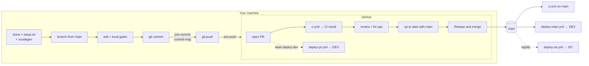

# Pull-request workflow — from clone to merge

The complete **manual** cycle for one change, and what runs where along the way: on your machine (git hooks), on GitHub
(workflows, rulesets, Dependabot) and after the merge (deploys). Rules behind it: [CLAUDE.md](../CLAUDE.md) §2–3.
Pipeline details and the security model: [ci-cd.md](ci-cd.md).



## 1. One-time setup (after cloning)

```bash
gh repo clone Charlesuru/RefProj && cd RefProj    # or: git clone https://github.com/Charlesuru/RefProj.git
./scripts/setup.sh                                # hooks, Ruby gems, local config templates
(cd iosApp && xcodegen generate)                  # or: bundle exec fastlane ios generate
```

Install the tools in [README → Requirements](../README.md#requirements) first; `setup.sh` stops and lists any that are missing.

| What | Does | Where it runs |
|---|---|---|
| `scripts/setup.sh` | `git config core.hooksPath .githooks` (activates the hooks below) · `bundle install` into `vendor/bundle` · copies `iosApp/Configs/Local.xcconfig` and `fastlane/.env` from their `.example` files if missing. Safe to re-run | locally, once |
| `xcodegen generate` | Generates `iosApp/RefProj.xcodeproj` from `iosApp/project.yml`. The project is **not** committed — re-run after every pull that changes `project.yml` | locally, as needed |
| `Local.xcconfig` | Set `DEVELOPMENT_TEAM` only if you run on a physical iPhone; simulators need nothing | locally |
| Firebase config *(optional)* | `app/android/google-services.json`, `iosApp/Firebase/<Env>/GoogleService-Info.plist` ([secrets.md](secrets.md#firebase-client-config)). Without them the app builds and runs; Firebase is simply off | locally |

Signing keys, store credentials and `fastlane/.env` values are only needed to **upload** builds, never for the PR cycle.

## 2. Ticket and branch

1. **Ticket first:** a Jira ticket `REF-123` with a spec and acceptance criteria. No ticket → draft one and get it approved.
2. **Branch from an up-to-date `main`** — before you change any code:
   ```bash
   git switch main && git pull --ff-only
   git switch -c feat/REF-123-short-description   # <type>/REF-123-short-description
   ```
   Types: `feat fix refactor perf test docs build ci chore`. Keep the branch short-lived (< 2 days); unfinished
   user-facing work goes behind a feature flag that is OFF in PROD ([feature-flags.md](feature-flags.md)).

## 3. Change the code and run the quality gates

Run the same gates CI runs, before you commit:

```bash
./gradlew spotlessApply                          # format
./gradlew spotlessCheck detekt                   # lint — zero findings
./gradlew allTests koverVerify                   # Android host + iOS simulator tests, coverage floors
./gradlew :app:android:assembleDevDebug          # Android build
bundle exec fastlane ios build env:dev           # iOS simulator build (or run RefProj-Dev in Xcode)
```

## 4. Commit — the local hooks

```bash
git add <files>
git commit -m "feat(login): add biometric unlock [REF-123]"
```

Two hooks run automatically on every commit (installed by `setup.sh`):

| Hook | When | Checks | On failure |
|---|---|---|---|
| [`pre-commit`](../.githooks/pre-commit) | before the commit is created | **gitleaks** on the staged changes (rules: [`.gitleaks.toml`](../.gitleaks.toml)); then `spotlessCheck` if any `.kt`/`.kts` file is staged | commit aborted. Secret: remove it (rotate it if real). Format: `./gradlew spotlessApply`, `git add`, commit again |
| [`commit-msg`](../.githooks/commit-msg) | after you write the message | subject is `<type>(<scope>): <summary> [REF-123]`, ≤ 100 chars. Exempt: `Merge …`, `Revert "…"`, `fixup!`/`squash!`/`amend!` | commit aborted; fix the message |

**Never** use `--no-verify`. The hooks are local only — CI re-checks secrets and lint, but not commit messages.

## 5. Push

```bash
git push -u origin feat/REF-123-short-description
```

| Hook | Checks | On failure |
|---|---|---|
| [`pre-push`](../.githooks/pre-push) | `spotlessCheck detekt` (the fast part of the gate; tests and builds run in CI) | push aborted; fix the findings |

## 6. Open the pull request

```bash
gh pr create --base main --title "REF-123: Add biometric unlock" --fill-first   # or the "Compare & pull request" button
```

- The description is pre-filled from [`.github/pull_request_template.md`](../.github/pull_request_template.md): ticket,
  what and why, how it was tested, checklist. Fill in every section.
- [`CODEOWNERS`](../.github/CODEOWNERS) requests a review from the code owner automatically.
- A new library needs its justification in the PR (license, maintenance, size, KMP support).

### What runs on GitHub when the PR is opened (and on every later push)

| Workflow / feature | What happens |
|---|---|
| [`ci.yml`](../.github/workflows/ci.yml) — job **Secret scan** | gitleaks over every commit in the PR |
| — **Workflow lint** | actionlint + zizmor on `.github/workflows` |
| — **Lint** | spotless + detekt; findings uploaded to *Security → Code scanning* (not for forks/Dependabot) |
| — **Test (Android host)** · **Build (Android)** | host, architecture and screenshot tests + coverage floors (table in the job summary); DEV debug APK (downloadable artifact) + PROD release AAB with R8 (unsigned) |
| — **Test + build (iOS)** | shared tests on the iOS simulator + DEV simulator build (macOS runner) |
| — **Dependency graph + review** | fails on new or upgraded dependencies with a known vulnerability (any scope), or — if they ship in an app — a license outside the allowlist ([ci-cd.md → License policy](ci-cd.md#license-policy)); comments on the PR only when it fails |
| — **CI result** | the single **required** check: green only if every job above succeeded or was skipped |
| Concurrency | a new push cancels the PR's running CI and starts over |
| [`deploy-pr.yml`](../.github/workflows/deploy-pr.yml) *(optional)* | add the label **`deploy:dev`** to send the PR's build to DEV testers (Firebase App Distribution + TestFlight); every push redeploys while the label is on. Not for forks or Dependabot. Remove the label when done |

Red CI: open the failing job's log (PR → *Checks*), reproduce locally with the commands from step 3, fix, push.

## 7. Review and updates

- Answer each comment, fix in **new commits** on the same branch and push (`git push` — the hooks run again, and so does CI).
  To fold a fix into an earlier commit instead: `git commit --fixup=<sha>`, then before merge
  `git rebase -i --autosquash origin/main` and `git push --force-with-lease` (only on your own branch).
- **All review threads must be resolved** before merge (ruleset). A push dismisses earlier approvals.
- Required approvals are currently **0**: GitHub does not let an author approve their own PR, and all PRs come from the
  owner's account. They become 1 once the AI has its own identity (plan step 8). A human still reviews and merges —
  never merge your own PR.

## 8. Bring the branch up to date

The ruleset requires the branch to be **up to date with `main`** (strict status checks). If `main` moved:

- GitHub: **Update branch → Update with rebase** (the button appears on the PR), or locally:
  ```bash
  git fetch origin && git rebase origin/main
  ./gradlew spotlessCheck detekt allTests          # re-verify after a conflict
  git push --force-with-lease
  ```
- CI runs again on the rebased commits; wait for a green **CI result**.

## 9. Merge — Rebase and merge (only)

The repository allows **Rebase and merge only**; squash and merge commits are disabled and `main` requires a linear history.

| | Rebase and merge (ours) | Squash and merge (disabled) |
|---|---|---|
| History on `main` | every commit of the PR, in order, no merge commit | one commit per PR |
| Commit messages | your Conventional Commits with ticket keys, exactly as checked by `commit-msg` | rewritten by GitHub at merge time — not checked |
| Implication | **each commit must stand on its own**: clean up WIP/fix-up commits before merge (step 7) | — |

How: PR → **Rebase and merge** → confirm. Or **Enable auto-merge** while CI is still running: GitHub merges when
**CI result** is green and the threads are resolved.

Rebase-merge gives the commits **new SHAs** on `main`. That matters for stacked PRs (a PR based on another PR's branch):
after each merge, rebase the next branch onto `main` —
`git rebase --onto origin/main <old tip of the merged branch> <next branch>` then `git push --force-with-lease`.
Retargeting alone does not start CI; the push does.

## 10. After the merge

| What | Where |
|---|---|
| The PR branch is deleted on GitHub automatically | repo setting `delete_branch_on_merge` |
| `ci.yml` runs again on `main` and refreshes caches + the dependency graph | GitHub Actions |
| [`deploy-main.yml`](../.github/workflows/deploy-main.yml) builds `main` and ships **DEV** (both platforms) — skipped for docs-only changes | GitHub Actions, environment `dev` |
| [`deploy-sit.yml`](../.github/workflows/deploy-sit.yml) ships **SIT** at 02:00 UTC Mon–Fri if `main` changed (or run it manually) | GitHub Actions, environment `sit` |
| STAGE/PROD only from a `vX.Y.Z` tag with approval | [ci-cd.md → Releasing](ci-cd.md#releasing) |

Clean up locally:

```bash
git switch main && git pull --ff-only
git fetch --prune
git branch -D feat/REF-123-short-description   # -D: rebase-merged commits have new SHAs, so git sees the branch as unmerged
```

## Dependabot pull requests

[`.github/dependabot.yml`](../.github/dependabot.yml) is configuration, not a workflow: GitHub's Dependabot service reads it and
opens PRs itself.

| | |
|---|---|
| When | Mondays, weekly, for Gradle (`/` and `/build-logic`), GitHub Actions (incl. SHA pins) and Ruby gems — only releases older than 7 days (cooldown). **Security updates** arrive immediately |
| Shape | grouped PRs (e.g. `kotlin-toolchain`, `androidx`, `actions`, `fastlane`), commit prefix `build(deps)` / `ci` |
| Checks | the same `ci.yml` and required **CI result**; no secrets, no `deploy:dev`, no SARIF upload |
| Not checked | commit-msg (local hook) — Dependabot subjects have no ticket key; that is accepted |
| Your part | read the changelog, check that grouped versions still fit together, then **Rebase and merge** like any PR. Behind `main`? Comment `@dependabot rebase`. Not wanted? `@dependabot ignore this major version` (or close it) |

Not covered by Dependabot — bump by hand in a normal PR: see [ci-cd.md → Dependency updates](ci-cd.md#dependency-updates).

## Quick reference

```bash
git switch main && git pull --ff-only
git switch -c feat/REF-123-thing
# … edit …
./gradlew spotlessApply spotlessCheck detekt allTests koverVerify :app:android:assembleDevDebug
git add -p && git commit -m "feat(thing): do the thing [REF-123]"        # pre-commit + commit-msg
git push -u origin feat/REF-123-thing                                     # pre-push
gh pr create --base main --title "REF-123: Do the thing" --fill-first     # ci.yml → CI result
# review → fix → push … → Update branch (rebase) → Rebase and merge
git switch main && git pull --ff-only && git branch -D feat/REF-123-thing
```
